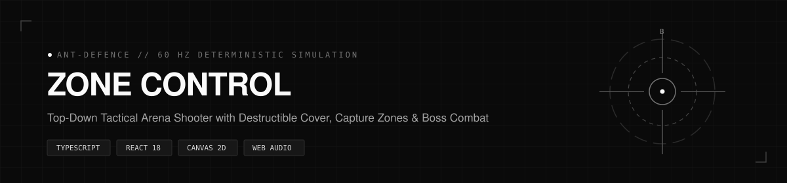
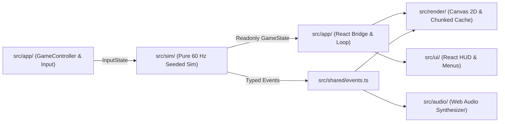
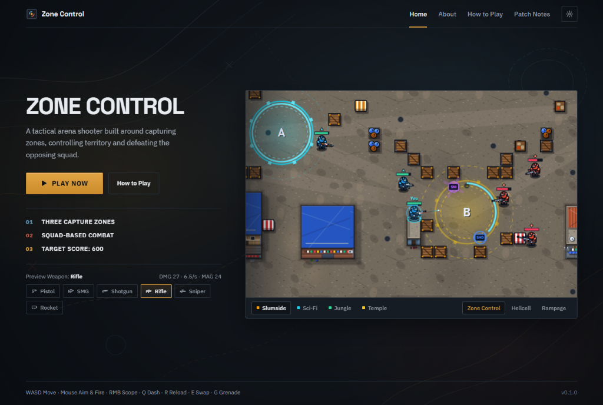
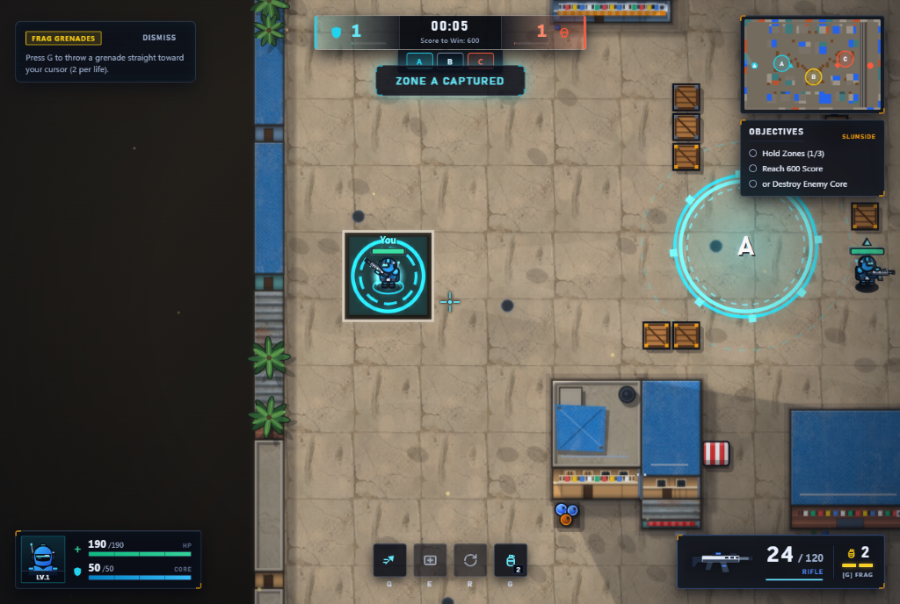
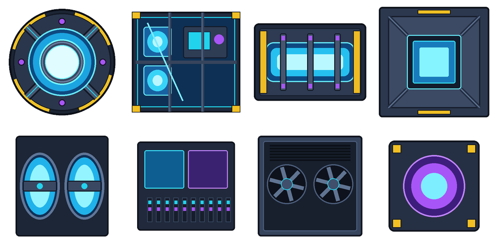
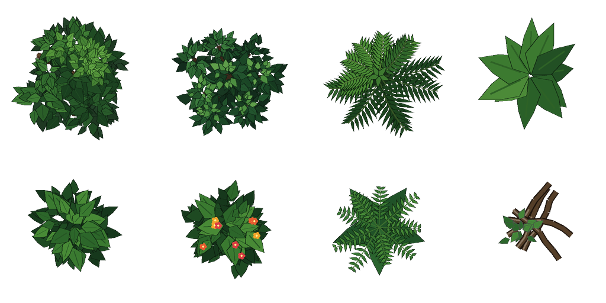
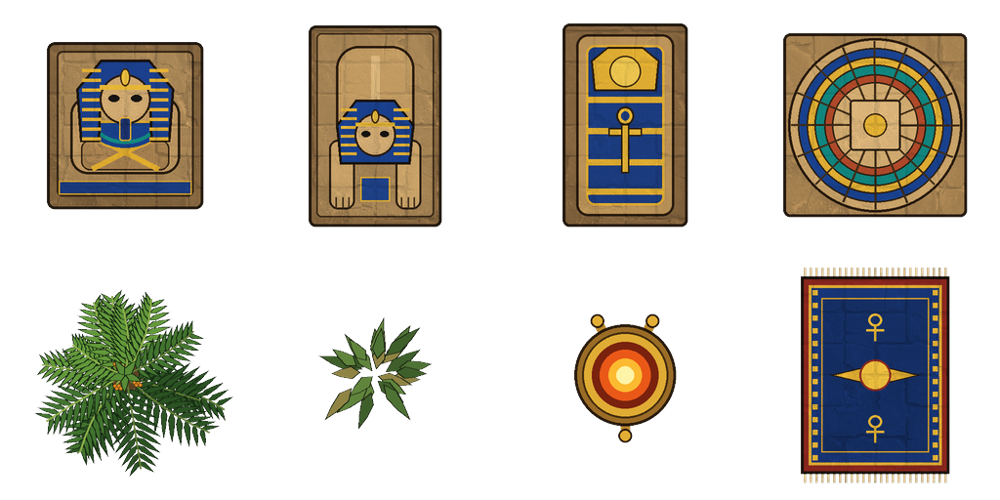

<div align="center">
  

  <br /><br />

  <p>
    <a href="https://arena4us.vercel.app"></a>
    
    
    
    
  </p>
</div>

---

## Overview

**Zone Control** (`ant-defence`) is a deterministic, browser-based top-down tactical arena shooter built with **TypeScript**, **React 18**, **Canvas 2D**, and **Web Audio synthesis**. Players command an operator alongside AI squadmates against respawning enemy forces across procedurally generated maps featuring destructible cover, three tactical capture zones, weapon pickups, and team base cores.

### The Problem It Solves

Browser action games frequently couple physics, AI, rendering, and UI state into a single frame loop—leading to frame-rate-dependent gameplay, non-reproducible bugs, and frame drops during heavy combat. Zone Control solves this by isolating a **pure, seeded 60 Hz simulation engine** from variable-rate Canvas 2D rendering, React HUD updates, and procedural Web Audio synthesis.

---

## Core Gameplay & Modes

| Feature | Description |
| :--- | :--- |
| **Zone Control (Standard)** | Capture and hold **Zones A, B, and C** to generate score over time while defending your team core. Contested zones pause capture progress. |
| **Hellcell Mode (PvPvE)** | Capturing Zones A and C triggers a temporary ceasefire and unleashes a wall-crushing **Boss** from Zone B (`crushObstaclesInRadius`, acid pools, venom cones, and boss projectiles). Dealing majority damage awards bonus points and restores HP and ammo. |
| **Rampage Mode (FFA)** | Free-for-all arena combat where every AI bot competes independently for the highest kill count. |
| **Destructible Cover** | Solid walls block movement and projectiles; low cover absorbs incoming fire (`coverHp`) and shatters when depleted, dynamically altering sightlines and AI pathing. |
| **Tactical Movement & Ordinance** | Directional dash (`Q` / `Shift` / `Space`), frag grenades (`G`, 2 per life, `110` splash radius), and timed supply crates with **Common / Rare / Epic** weapon drops. |
| **Four Procedural Biomes** | Distinct visual themes and tile atlases: **Fortress**, **Jungle**, **Temple**, and **Slumside**. |

---

## Arsenal & Balance Specification

All weapon statistics are governed by a single source of truth (`WEAPON_DEFS` and `GRENADE_DEF` in [`src/shared/api.ts`](src/shared/api.ts)).

| Weapon | Rarity | Damage | Fire Rate | Mag Size | Reload | Range | Notes |
| :--- | :--- | :--- | :--- | :--- | :--- | :--- | :--- |
| **Pistol** | Common | `24` | `5.0 /s` | `12` | `1.2 s` | `600` | Semi-auto sidearm |
| **SMG** | Common | `15` | `12.0 /s` | `30` | `1.6 s` | `520` | Automatic close-quarters |
| **Shotgun** | Rare | `11 × 8` | `1.4 /s` | `6` | `2.1 s` | `360` | 8-pellet spread |
| **Rifle** | Rare | `27` | `6.5 /s` | `24` | `1.8 s` | `820` | Automatic mid-range |
| **Sniper** | Epic | `90` | `0.8 /s` | `5` | `2.5 s` | `1500` | High-velocity precision |
| **Rocket** | Epic | `75` | `0.6 /s` | `3` | `2.8 s` | `900` | `100` unit splash radius |
| **Grenade** | Ordinance | `105` | `3.0 s CD` | `2 / life` | — | `440 spd` | `1.15 s` fuse, `110` splash |

---

## System Architecture

The codebase enforces strict unidirectional data flow. `src/sim/` contains zero DOM, React, Canvas, `Date.now`, or `Math.random` calls.



### Module Structure

```text
src/
├── shared/     # Domain contract: types.ts, events.ts, api.ts (WEAPON_DEFS)
├── sim/        # Pure deterministic simulation: RNG, map, physics, combat, AI/A*, hellcell
├── app/        # Fixed-step driver, input capture, React bridge, headless benchmark
├── render/     # Canvas 2D renderer, camera, interpolation, chunked ground cache, biomes
├── ui/         # HUD, menus, design tokens, settings, ?showcase=1 dev preview
└── audio/      # Synthesized Web Audio engine with stereo panning & voice pooling
```

---

## Screenshots

| Main Menu | Active Arena Combat |
| :---: | :---: |
|  |  |

---

## Biome Texture Atlases

Each map theme renders using dedicated procedural architecture, lighting, and tile assets stored in `public/assets/`.

| Fortress | Jungle | Temple |
| :---: | :---: | :---: |
|  |  |  |

---

## Performance Engineering

Measured and documented in [`docs/perf-baseline.md`](docs/perf-baseline.md) and [`docs/perf-results.md`](docs/perf-results.md):

| Metric | Before | After Optimization | Implementation |
| :--- | :--- | :--- | :--- |
| **`20v20` Headless Benchmark (2,000 ticks)** | `1.015 ms/step` | **`0.595 ms/step`** | `<= 3.0 ms/step` budget (`src/app/benchmark.test.ts`) |
| **`4v4` Hellcell `sim.step` Avg** | `0.137 – 0.185 ms` | **`0.039 – 0.050 ms`** | Generation-stamped typed-array A* scratch |
| **A* Pathfinding Calls / Tick** | `max 7` | **`max 3`** | `MAX_ASTAR_PER_TICK = 3` + batched `mapVersion` |
| **Full Ground-Cache Rebuilds (30s Boss)** | `60 – 138` | **`0` extra rebuilds** | `ChunkedGroundCache` (`8×8`-tile dirty chunks) |

---

## Getting Started

### Prerequisites

- **Node.js** `>= 20`

### Installation & Local Run

```bash
npm ci
npm run dev
```

Open `http://localhost:3000/` in your browser (`npm start` is an alias for `npm run dev`).

- `?showcase=1` — Opens the presentation showcase (stub simulation preview).
- `?perf=1` — Enables the live performance telemetry overlay (`window.__ZONE_PERF__`).
- `npm run build` — Runs `tsc --noEmit` and builds the production bundle into `dist/`.
- `npm run preview` — Serves the production build on port `4173`.

---

## Controls

| Input | Action |
| :--- | :--- |
| `W` `A` `S` `D` | Move |
| `Mouse` | Aim |
| `Left Click` | Fire |
| `R` | Reload |
| `E` | Pick up / swap nearby weapon |
| `Q` / `Shift` / `Space` | Tactical dash |
| `G` | Throw grenade |
| `Esc` / `P` | Pause / resume |
| `Enter` | Play again after match end |

> **Note:** Gamepad input is supported for menu navigation; active combat requires keyboard and mouse.

---

## Testing & Verification

```bash
npm run typecheck   # TypeScript strict check (no 'any')
npm test            # Vitest suite (sim, determinism, events, render, audio, UI, 2000-tick benchmark)
npm run build       # Production verification build
npm run balance     # Headless balance simulation runner (scripts/balance-sim.ts)
```
