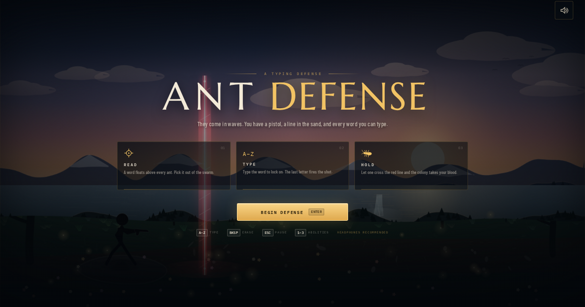

# ANT DEFENSE

A keyboard-driven typing defense game. Hold the pass against waves of word-bearing ants, survive royal assaults, and keep the colony behind the red line.



## Features

- Typing-based targeting with prefix-free words and instant shooting.
- Five ant types, including armored giants and multi-hit queens.
- Escalating waves, combos, accuracy tracking, and three abilities.
- Procedural sunset scenery, vector characters, and synthesized audio.
- Responsive HUD for desktop and laptop screens.
- No backend, API keys, or environment variables required.

## Controls

| Key | Action |
| --- | --- |
| `A-Z` | Type the active word; the final letter fires |
| `Backspace` | Erase the current prefix |
| `Escape` | Pause or resume |
| `Enter` | Start, resume, or restart |
| `1` | Focus: slow the colony |
| `2` | Aegis: block breaches |
| `3` | Power: load three piercing rounds |
| `M` | Mute or unmute while paused |

## Development

Requires Node.js 20 or newer.

```bash
npm ci
npm run dev
```

Open `http://localhost:3000/`.

```bash
npm run typecheck
npm run build
npm run preview
```

## Deploying to Vercel

Import the GitHub repository into Vercel and use the detected Vite settings:

- Build command: `npm run build`
- Output directory: `dist`
- Install command: `npm ci`
- Root directory: `.`
- Environment variables: none

Or deploy from the CLI:

```bash
npx vercel
npx vercel --prod
```

## Project structure

```text
src/
  components/   React HUD and overlays
  game/         Canvas engine, ants, scenery, effects, audio, words
  utils/        Formatting helpers
public/         Favicon and social preview image
```

All visual effects and sound are generated at runtime. The game is designed for a physical keyboard and is best played on a desktop or laptop.
